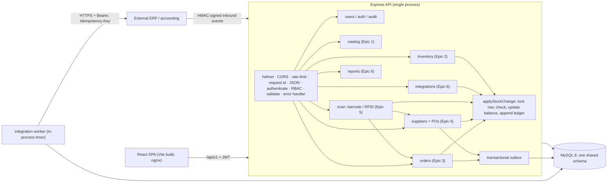

# Architecture

RIMS is a **modular monolith**: one Express process, one MySQL database, one auth system, one React SPA.
Modules live under `backend/src/modules/<name>` and only talk to each other through exported service functions
(never through each other's tables, except read-only reporting), so any module can later be extracted into a service.

## Cross-cutting rules
* **Stock changes only via `applyStockChange`** (`modules/inventory/stock.ts`). It locks the balance row
  (`SELECT … FOR UPDATE`), rejects any change that would break `on_hand >= 0` or `reserved <= on_hand`, updates the
  balance, and appends one immutable row to `inventory_movements`. The same invariants are also `CHECK` constraints,
  and the ledger/audit tables reject `UPDATE`/`DELETE` through triggers.
* **Transactions** use `withTx` (auto-rollback, deadlock retry). Multi-row operations lock in a stable order (product id; location id for transfers).
* **RBAC**: `authenticate` verifies the JWT then reloads the user, role, permissions and location scope from the DB on every request
  (deactivation/role changes take effect immediately). `requirePermission(...)` guards every route; location scope is applied in services.
* **Errors**: `AppError` + Zod + MySQL error mapping → `{ error: { code, message, details?, requestId } }`. No stack traces or SQL in responses.
* **Outbox**: `order.fulfilled` and `goods.received` events are inserted in the same transaction as the business change; a worker delivers them with retries.

## Layering
Catalog is the reference implementation: `routes → controller → service → repository (+ schemas)`.
Other modules use `routes → service (SQL inside) + schemas`; the SQL is still parameterized and isolated from HTTP concerns.
Splitting those services into repositories is mechanical and recommended when a module grows.

## Location scope
Admin: all locations. Any role with rows in `user_locations`: only those. Store Manager with none: no locations. Other roles with none: all.
